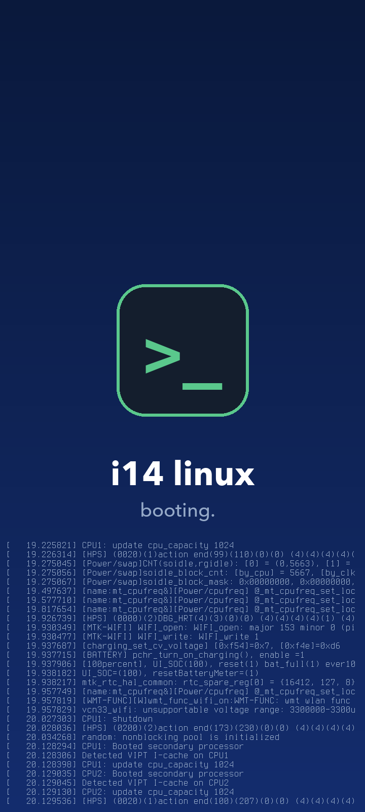
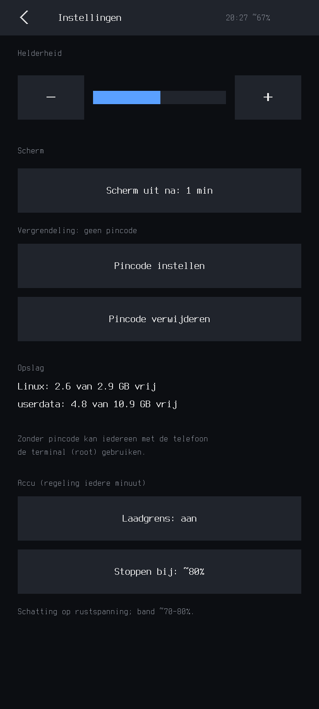

<h1 align="center">I14 Linux</h1>

Turning an inexpensive Topiky phone into a standalone Linux computer.

<a href="docs/STATUS.md">What works?</a> · <a href="docs/HARDWARE.md">The phone</a> · <a href="docs/HISTORY.md">History</a> · <a href="docs/DEVELOPMENT.md">Building</a> · <a href="docs/ROADMAP.md">Roadmap</a>

I14 Linux runs Alpine directly on a phone with a MediaTek MT6735.
A custom touch interface, terminal, Wi-Fi settings and charging controller turn
it into a small Linux computer. One practical use is a backup DNS server running Unbound.

The device was purchased as a **Topiky**, model **Topikyg3im86nzcv-13**, through
[Amazon.nl, ASIN B0CJ64KTBN](https://www.amazon.nl/dp/B0CJ64KTBN).
Its original firmware identifies it as **I14 Pro Max**. This project targets
that specific device and motherboard (`magc6735_65u_1_m0`, firmware branch `P45`).

> [!IMPORTANT]
> Experimental device port. The current installation runs **Alpine 3.24.3 on the
> original MediaTek 3.18.19 kernel**. Android is no longer started.
> The modern **7.0.10 mainline port** is a separate experiment, currently on hold.
> There is no universal installation image for other devices sold as “I14”.

> [!WARNING]
> **Hardware, data-loss and battery risk:** Flashing boot, recovery or partition
> images, modifying preloader/seccfg state, or experimenting with charging/PMIC
> controls can permanently brick a phone, erase NVRAM/IMEI calibration data, or
> cause unsafe battery behavior. Make and verify your own full backup first.
> Everything in this repository is provided **AS IS**, without warranty of any
> kind; you are solely responsible for any damage to your hardware.

## On the screen

  
  &nbsp;&nbsp;
  

Unmodified framebuffer captures from the device: the boot screen and settings
with the charge limit. `~80%` is an estimate based on open-circuit voltage,
not an independently calibrated state of charge. The original interface is in Dutch.
[Screenshot provenance and limitations](docs/SCREENSHOTS.md).

## Why this project?

The listing advertised Android 13, eight CPU cores and 8 GB of RAM.
The device examined had Android 6, four available CPU cores and roughly
2 GB of RAM; its eMMC is about 16 GB. The listing itself gives conflicting
storage capacities. Measurements are therefore documented separately from sales claims.
[The listing versus the device](docs/HARDWARE.md).

The project began with inventory and cleanup. Backups, native Linux, custom boot
and rescue paths, network services and local touchscreen controls followed.
The original software included an unclear updater, an `AutoDialer`, and factory
and logging tools. Their presence is documented; that alone does not establish
malicious behavior. [A short history](docs/HISTORY.md).

## What works now?

Status: **22 November 2026** (separating the historical 2–5 November v9 baseline,
later v10c/B5 device checks, and source-only hardening/Rust tooling). “Yes” means
demonstrated on this device; [the detailed status](docs/STATUS.md) describes the
exact tests and limitations.

| Component | Working | Notes |
| --- | --- | --- |
| Native Alpine, storage and reboot | Yes | Linux rootfs (`B5`) on eMMC with `v10c` boot image, OpenRC and `apk` |
| Display and touch controls | Yes | Custom framebuffer interface and on-screen keyboard |
| On-device terminal | Historical / disabled in hardened DNS image | Exercised in the 2–5 Nov v9 baseline; disabled in the hardened DNS image on `main` (see [docs/DEVELOPMENT.md](docs/DEVELOPMENT.md)) |
| Wi-Fi and SSH | Yes | On-screen network selection and SSH key authentication |
| USB management and rescue mode | Yes | USB networking (`172.16.42.1`) and rescue mode; hardened source restricts normal USB management to SSH keys and uses locally activated, authenticated serial rescue |
| Backup DNS | Yes | Tested on UDP/TCP port 53, with DNS-over-TLS and DNSSEC; verify Unbound security advisories before exposing to LAN clients (see [SECURITY.md](SECURITY.md)) |
| Brightness, screen timeout, PIN and power menu | Yes | Implemented and exercised on the device |
| Charging and configurable charge limit | Partially | Charging works; BCCT pause/resume tested, full calibration/charge-band acceptance still pending |
| CPU control with the screen off | Yes | Downclocking works; energy savings have not been established |
| Rust userspace & host tools | Source / host-verified | 12-crate workspace (`rust/`) with offline backup verifier (`i14-verify-backup`) and ARM64 musl builds; full on-device migration acceptance open |
| Bluetooth | Partially | Radio and scanning work; pairing and device use are not implemented |
| Audio, camera, GPS, calls and mobile data | Not verified | No complete, accepted Linux support |
| Modern mainline kernel | Partially | Earlier native boot demonstrated; not a complete replacement for 3.18 |
| Docker | No | Not supported by the current kernel |
| Multi-day reliability / recovery from an empty battery | Partially | Acceptance window B passed for its measured version; 48-hour Soak C and nearly-empty recovery remain open |

## How does it work?

The existing bootloader loads a boot image containing the original kernel and
our `/i14init` startup program. It checks storage and starts Alpine from an
ext4 image on userdata. OpenRC manages network services, the touch interface,
CPU control and the charging guard. A custom USB rescue mode handles startup failures.

The original interface uses the Python standard library and draws directly to
`/dev/fb0`; the `rust/` workspace implements native Rust replacements and host
tools. Wi-Fi uses the original MediaTek driver and a few vendor files extracted
from the device's own firmware backup. Those binaries are not distributed here.

## Exploring or building

There is no ready-made release yet. Source code, configuration and host tests
are included; firmware, rootfs images, keys and personal device data remain local.
Building requires additional tools and files from the device itself.
[Development and building](docs/DEVELOPMENT.md).

| Directory | Contents |
| --- | --- |
| `rust/` | 12-crate Rust workspace: native phone services/UI, offline backup verifier and host fastboot/boot tools ([rust/README.md](rust/README.md)) |
| `rootfs/` | Alpine builder, OpenRC services and Python touch interface |
| `initramfs/` | Startup, charging and rescue programs |
| `kernel/` | Experimental mainline device trees, patches and driver work |
| `scripts/` | Build, diagnostic, backup, soak-audit and installation tools |
| `tools/` | Small native C utilities |
| `tests/` | Host tests for the interface, charging policy, boot images, rollback and recovery |
| `assets/` | Project icon and unmodified device framebuffer captures |
| `docs/` | Hardware, current status, roadmap, history and verification |

## Documentation

- [Current status and remaining work](docs/STATUS.md)
- [Roadmap and acceptance gates](docs/ROADMAP.md)
- [Topiky listing and observed hardware](docs/HARDWARE.md)
- [History and suspicious preinstalled software](docs/HISTORY.md)
- [Screenshots and provenance](docs/SCREENSHOTS.md)
- [Development environment and build limitations](docs/DEVELOPMENT.md)
- [Rootfs trial and rollback](docs/ROOTFS-SWAP-ROLLBACK.md)
- [K70 recovery-timing analyzer](docs/K70-RECOVERY-TIMING.md)
- [Security policy](SECURITY.md)
- [What this GitHub publication includes](docs/PUBLISHING.md)

## Licensing

Original userspace code, Rust crates, scripts, tools, initramfs scripts and
documentation in this repository are licensed under the [MIT License](LICENSE).

Files under `kernel/` follow their respective upstream-compatible licenses:
- Kernel modules and headers (`kernel/*.c`, `kernel/*.h`, `kernel/dtb-shim.S`): `GPL-2.0-only`
- Upstream Linux kernel patches (`kernel/patches/*.patch`): `GPL-2.0-only`
- Device tree sources (`kernel/*.dts`): `BSD-3-Clause`

The kernel work builds on [MT6735 Mainline](https://gitlab.com/mt6735-mainline).
Alpine, Linux, BusyBox, OpenRC, Unbound and other third-party components retain
their own licenses.
